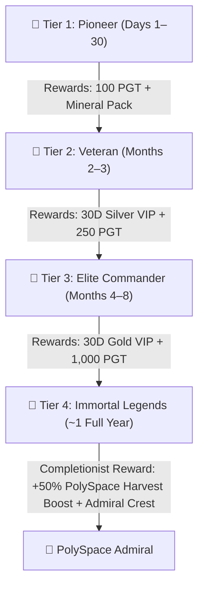

# Player Profile Achievements & Long-Term Progression (PLAN-016)

## Executive Summary
This specification defines the architecture, progression curve, anti-cheat security model, and in-game rewards for the **Player Profile Achievements System** in **Polygon Gaming**.

The system introduces a dedicated **🏆 Achievements** sub-tab inside **My Profile** (`#modal-profile`), providing structured daily, monthly, and multi-year goals. The endgame milestones are calibrated to take **approximately 1 full year (365 days)** of sustained activity to achieve 100% completion.

All rewards are **100% in-game and account-bound** (requiring **zero new smart contracts or gas fees**), and all claim verifications are executed strictly server-side via `SECURITY DEFINER` PostgreSQL RPCs to eliminate cheating, API spoofing, and automated bot exploitation.

---

## 1. Core Architecture & Anti-Cheat Security

### A. Zero Client Trust
* The browser client **never** dictates whether an achievement is unlocked.
* Clicking "🎁 Claim Tier Reward" invokes a server-authoritative RPC: `public.claim_achievement_tier(p_tier_id)`.
* The RPC inspects the live, verified PostgreSQL record in `public.users` directly. If any requirement is unfulfilled, the transaction aborts with an error and logs a security entry.

### B. Immutable Server-Side Metrics
Every achievement relies on statistics already guarded by server-side cryptography and security triggers:
* **Faucet Streaks & Total Claims**: Controlled by `claim_faucet` (enforces 24h clock, IP clustering checks, and Cloudflare Turnstile token validation).
* **Arcade Plays & High Scores**: Controlled by `end_arcade_session` (enforces minimum play duration, speedhack checks, and session cryptography).
* **PolySpace Fleet & Warp Levels**: Managed server-side by `claim_polyspace_expedition`.
* **Balance & PGT Earned**: Protected by the PostgreSQL `prevent_direct_balance_mutation` trigger.

### C. Anti-Exploit Guardrails
1. **Lifetime One-Time Claim**: Stored in `users.claimed_achievement_tiers` (JSONB array `[1, 2, 3, 4]`). Re-claiming any tier is strictly blocked.
2. **Account Age Enforcement**:
   * **Tier 3**: Account must be at least **90 days old** (`created_at <= NOW() - INTERVAL '90 days'`).
   * **Tier 4**: Account must be at least **300 days old** (`created_at <= NOW() - INTERVAL '300 days'`).
3. **Clean Standing Requirement**: Account must have `is_banned = false` and `bot_warning = 0`.
4. **Web3 Authentication**: Must have an authenticated Web3 session (`auth.uid() IS NOT NULL` and valid `linked_wallet_address`).

---

## 2. The 4-Tier Progression Curve (1-Year Calibration)



### 🥉 Tier 1: Pioneer (Days 1 – 30)
*Early onboarding milestones that players unlock during their first month.*
1. **First Ignition**: Claim your first 24h Faucet (`total_claims >= 1`).
2. **Weekly Dedication**: Reach a 7-day Faucet streak (`faucet_streak >= 7`).
3. **Orbital Pilot**: Score 5,000+ in *Astro-Dodge* (`alltime_game_highscore >= 5000`).
4. **Neon Racer**: Drift 5,000m in *Cyber Drift* (`alltime_drift_highscore >= 5000`).
5. **Skyscraper**: Reach Floor 25 in *Cyber Stacker* (`alltime_stacker_highscore >= 25`).
6. **Space Cadet**: Upgrade PolySpace Warp Engine to Level 5 (`warpLevel >= 5`).
7. **First Relic**: Discover your first in-game Quantum Relic (Total relics owned >= 1).

**Tier 1 Completion Reward (100% In-Game)**:
* **100 PGT** credited to balance.
* **PolySpace Resource Crate**: `5,000 Iron` + `1,500 Titanium` + `250 Quantum` *(accelerates early Warp Engine upgrades)*.
* **Profile Badge**: `🥉 Pioneer Pilot`.

---

### 🥈 Tier 2: Veteran (Months 2 – 3)
*Requires consistent weekly dedication, skill, and economy participation.*
8. **Monthly Habit**: Reach a **30-day** uninterrupted Faucet streak (`faucet_streak >= 30`).
9. **Centurion**: Play **500 total arcade game sessions** (`total_arcade_plays >= 500`).
10. **High-Velocity Ace**: Score **25,000+ in Astro-Dodge** OR **75,000m in Cyber Drift**.
11. **Deep Miner**: Mine **250,000 total minerals** in PolySpace (`mineralsMinedTotal >= 250000`).
12. **Fleet Commander**: Upgrade Warp Engine to **Level 12** (`warpLevel >= 12`).
13. **Leviathan Hunter**: Deal **250,000 total damage** to the World Boss (`alltime_boss_damage >= 250000`).
14. **Relic Collector**: Hold at least **6 unique** Quantum Relics in your vault.

**Tier 2 Completion Reward (100% In-Game)**:
* **30-Day Silver VIP Status** *(1.25x arcade multiplier, VIP POL faucet access, and reduced cooldowns)*.
* **250 PGT** credited to balance.
* **Profile Badge**: `🥈 Fleet Veteran`.

---

### 🥇 Tier 3: Elite Commander (Months 4 – 8)
*Long-term dedication across multiple game modes and community participation.*
15. **Century Streak**: Reach a **100-day** Faucet streak (`faucet_streak >= 100`).
16. **Arcade Master**: Complete **1,500 total arcade game sessions** (`total_arcade_plays >= 1500`).
17. **Exoplanet Tycoon**: Complete **500 PolySpace fleet expeditions**.
18. **Mega-Titan Slayer**: Deal **1,000,000 total damage** to the World Boss (`alltime_boss_damage >= 1000000`).
19. **Vault Staker**: Stake **1,000+ PGT** in the PolyGame Staking Vault (`staked_balance_pgt >= 1000`).
20. **Relic Custodian**: Hold **12 of 17** Serie 1 Quantum Relics in your vault.

**Tier 3 Completion Reward (100% In-Game)**:
* **30-Day Gold VIP Status** *(full 2.0x payouts across arcade games + double faucet yields)*.
* **1,000 PGT** credited to balance.
* **Profile Badge**: `🥇 Elite Commander`.

---

### 👑 Tier 4: Immortal Legends (~9 – 12 Months / The 1-Year Grind)
*The ultimate prestige milestones that strictly require ~1 full year of continuous play.*

21. **☀️ Solar Orbit (365 Days)**:
    * Reach a **365-day Faucet Streak** *(or 365 total lifetime claim days)*.
22. **🎮 Arcade Legend (3,650 Sessions)**:
    * Complete **3,650 total arcade sessions** (~10 sessions per day for a full year).
23. **🌌 Void Sovereign (Warp Level 20)**:
    * Reach **Warp Engine Level 20** in PolySpace (requires millions of iron, titanium, and quantum matter).
24. **🪐 Interstellar Fleet (1,500 Expeditions)**:
    * Successfully launch and claim **1,500 PolySpace expeditions**.
25. **🔮 The Complete Cosmos (17/17 Relics)**:
    * Discover and hold **all 17 Serie 1 Quantum Relics** (completing the full Apex set).
26. **💰 PGT Centimillionaire**:
    * Accumulate **25,000+ PGT** in total lifetime earnings (`total_earned >= 25000`).

**Tier 4 Grand Prize (Soulbound In-Game Trophy)**:
* **Permanent Account Perk: "🌌 PolySpace Admiral"**:
  * **+50% Permanent Harvest Boost** to all PolySpace expeditions, mineral extracts, and PGT ore.
  * Stored on the account profile: `users.has_admiral_boost = true`.
* **Mythic Profile Frame**: Golden animated neon halo around player avatar across all leaderboards and profiles.
* **Immortal Title**: `👑 PolySpace Admiral`.

---

## 3. User Interface & Profile Integration

### Sub-Tab Navigation (`src/js/features/profile.js`)
Inside `renderProfileModal()` / `switchProfileSubTab(subTab)`:
* Sub-tabs:
  1. `tab-btn-profile-career`: **`👤 Career & Stats`**
  2. `tab-btn-profile-relics`: **`🏺 Quantum Relics`**
  3. `tab-btn-profile-achievements`: **`🏆 Achievements`** *(New)*

### Visual Elements:
1. **Master Progress Bar**:
   * Header displaying `Total Completed: X / 26 (Y%)`.
   * Unlocked badges dynamically illuminated.
2. **Tier Accordion Cards**:
   * Each tier features a card with an active progress counter (e.g., `Tier 2: 5/7 Completed`).
   * Individual achievement rows with real-time percentage bars (e.g. `Faucet Streak: 21 / 30 Days [70%]`).
3. **Claim Button State**:
   * Disabled with padlock icon when incomplete.
   * Turns radiant animated gold with **"🎁 Claim Tier Reward"** once 100% of prerequisites are met.
4. **Retroactive Recognition**:
   * Because statistics already reside in Supabase, veteran players opening the tab for the first time will immediately see their real progress credited (e.g. players with 1,000+ arcade plays or high Warp levels instantly have those checked off).

---

## 4. Database Schema Requirements

### Column Additions to `public.users`:
```sql
ALTER TABLE public.users 
ADD COLUMN IF NOT EXISTS claimed_achievement_tiers JSONB NOT NULL DEFAULT '[]'::jsonb,
ADD COLUMN IF NOT EXISTS has_admiral_boost BOOLEAN NOT NULL DEFAULT FALSE;
```

### Server Stored Procedure:
* `public.claim_achievement_tier(p_tier_id INT) RETURNS JSONB`
* `SECURITY DEFINER` executing as `postgres`.
* Validates tier criteria, appends tier to `claimed_achievement_tiers`, atomically credits rewards, and returns the updated state.
