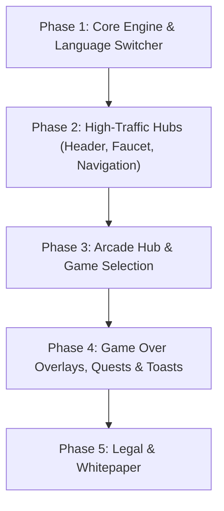

# Polygon Gaming — Multi-Language Internationalization & Localization

> **Plan ID**: `PLAN-018`  
> **Codename**: PolyLocale  
> **Target Platform**: Polygon Gaming (`https://polygongaming.io/`)  
> **Architecture**: Vanilla HTML/CSS/JavaScript with Supabase PostgreSQL backend  
> **Status**: Planned / Reference  

---

## 1. Executive Summary
This document outlines the architectural roadmap for introducing multi-language localization (i18n) to Polygon Gaming. The goal is to open up access for international Web3 gaming communities (LATAM, Francophone, East Asia, and Southeast Asia) while keeping the platform zero-dependency, lightning-fast on mobile, and fully backward-compatible with GitHub Pages hosting.

---

## 2. Priority Target Languages

| Code | Language | Primary Regions | Web3 Gaming Market Fit |
| :--- | :--- | :--- | :--- |
| **`en`** | **English** (Default) | Global, US, UK, EU | Base platform standard |
| **`es`** | **Spanish** | LATAM, Spain | Massive crypto arcade & play-to-earn community |
| **`pt-BR`** | **Portuguese (Brazil)** | Brazil, Portugal | High daily active faucet & arcade users |
| **`fr`** | **French** | France, Canada, West Africa | Strong European and Canadian gamer presence |
| **`ja`** | **Japanese** | Japan | Strong affinity for retro/arcade games & NFT collectibles |
| **`ko`** | **Korean** | South Korea | Leading esports & gaming economy |
| **`zh-CN`** | **Chinese (Simplified)** | East Asia, Global diaspora | Major Web3 liquidity and DeFi/gaming participation |
| **`tl`** / **`vi`** | **Filipino / Vietnamese** | Philippines, Vietnam | Leading mobile gaming and crypto faucet adoption |

---

## 3. Architecture: Zero-Dependency Client-Side Engine

Because Polygon Gaming operates without heavy Node/React build steps, we use a modular, lazy-loaded dictionary architecture:

```
PolyGame/
├── locales/
│   ├── en.json              # Base English dictionary (fallback)
│   ├── es.json              # Spanish strings
│   ├── pt.json              # Portuguese strings
│   ├── fr.json              # French strings
│   ├── ja.json              # Japanese strings
│   └── zh.json              # Simplified Chinese strings
├── src/js/core/
│   └── i18n.js              # Localization engine & DOM scanner
└── index.html               # Declarative data-i18n attributes
```

### Core Engine Responsibilities (`src/js/core/i18n.js`):
1. **Language Detection & Persistence**:
   - Detects saved language from `localStorage.getItem('poly_lang')`.
   - Defaults to `navigator.language` if supported; falls back to `'en'`.
2. **On-Demand Lazy Loading**:
   - Only downloads `locales/{lang}.json` (~20–30 KB) when selected, preserving instant mobile page speeds.
3. **Declarative DOM Translation**:
   - Scans for all elements matching `[data-i18n]`:
     ```html
     <button id="btn-claim-faucet" data-i18n="faucet.claim_btn">Claim 50 PGT</button>
     <input type="text" data-i18n-placeholder="auth.search_placeholder" placeholder="Search...">
     ```
4. **Dynamic Interpolation in JavaScript (`i18n.t`)**:
   ```javascript
   // In game.js, faucet.js, or profile.js:
   window.i18n.t('payout.won_pgt', { amount: 150.5, game: 'Astro-Dodge' });
   // "You won 150.50 PGT in Astro-Dodge!"
   ```
5. **DOM Mutation Observer**:
   - Automatically translates dynamically generated cards, tooltips, and modals when they open.

---

## 4. Phased Implementation Roadmap



### **Phase 1: Core Engine & Header Switcher**
- Build `src/js/core/i18n.js`.
- Add language selector dropdown (`🌐 EN ▾`) to desktop header and mobile drawer.
- Create initial `locales/en.json` base template.

### **Phase 2: High-Traffic Portals & Faucet**
- Translate:
  - Top navigation tabs (Earn, Arcade, Adventure, Vault, Hangar).
  - 24-Hour PGT Faucet card, claim celebration modal, and boost prompts.
  - Web3 wallet connect / guest status modal.

### **Phase 3: Arcade Hub & Leaderboards**
- Translate:
  - Mini-game cards (Astro-Dodge, Cyber Invaders, Cyber Drift, Cyber Stacker, Cyber Tetris, etc.).
  - Gameplay controls and instructions.
  - Leaderboard headers, rank titles, and the Sunday reset notice.

### **Phase 4: In-Game Overlays, Quests & Dynamic Alerts**
- Translate:
  - Game Over score cards ("New High Score!", "Base PGT", "Multiplier", "Play Again").
  - Daily Quest tasks and Referral shop items.
  - Toast notifications and system popups.

### **Phase 5: Legal Documents & Whitepaper**
- Add language switcher toggle to `terms.html`, `privacy.html`, and `whitepaper.html`.

---

## 5. Technical Guardrails & Security Invariants

1. **Non-Translatable Entities**:
   - Token symbols and chain identifiers (`PGT`, `POL`, `Polygon`, `EVM`, `RPC`, `NFT`, `VIP`) must remain identical across all languages.
2. **Safe Fallback Handling**:
   - If a translation key is missing in a specific locale, the engine must transparently fallback to English (`en`) without throwing errors or leaving blank text.
3. **Security Invariant**:
   - Backend RPC parameters, database column references, and balance calculation payloads must remain strictly language-agnostic. Translations only apply to the presentation layer.
